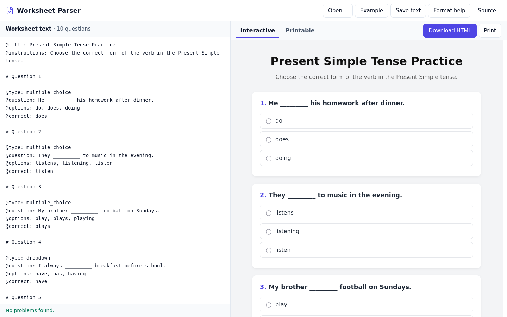
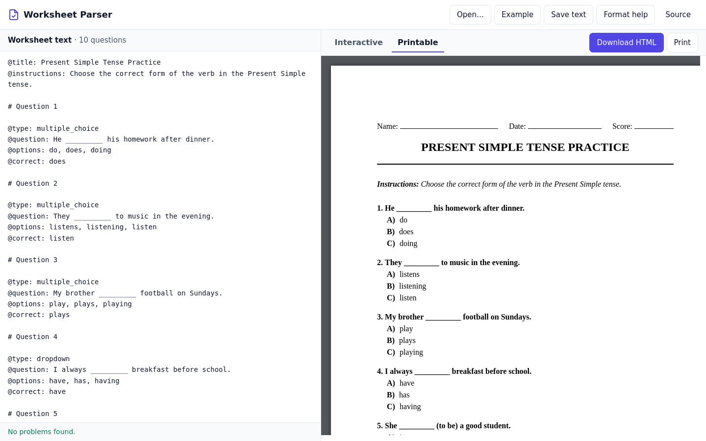

# Worksheet Parser

[](https://github.com/bugracdnc/worksheetparser/actions/workflows/pages.yml)

Write a worksheet as plain text, get two HTML files back: an **interactive** one students fill in on screen (instant right/wrong feedback) and a **printable** A4 one with name/date/score lines.

**Try it in your browser: https://bugracdnc.github.io/worksheetparser/** — nothing to install, nothing is uploaded; the parser runs locally as WebAssembly.



## Format

One setting per line as `@key: value`. Lines starting with `#` are comments, blank lines are ignored. `@correct` closes a question.

```text
@title: Present Simple
@instructions: Choose the correct answer.

# radio buttons
@type: multiple_choice
@question: He _____ his homework after dinner.
@options: do, does, doing
@correct: does

# select box
@type: dropdown
@question: She _____ a good student.
@options: is, are, am
@correct: is

# free text, checked case-insensitively
@type: fill_blank
@question: They _____ to school by bus.
@correct: go
```

Mistakes (unknown keys or types, a missing `@correct`, a correct answer that isn't one of the options) are reported with line numbers instead of silently dropped. More examples: [`examples/`](examples).



## Command line

```sh
go install github.com/bugracdnc/worksheetparser/cmd/worksheetparser@latest
worksheetparser examples/example.wsp.txt
# -> examples/example.wsp.txt_interactive.html
# -> examples/example.wsp.txt_printable.html
```

On Windows you can drag a `.wsp.txt` file onto `worksheetparser.exe`.

## Development

```sh
make test    # go test ./...
make build   # CLI binary
make serve   # builds the WebAssembly editor into web/ and serves it on :8080
```

| Path | What |
|---|---|
| `internal/parser` | text → `Worksheet`, with warnings |
| `internal/generator` | `Worksheet` → HTML (`templates/*.gohtml`) |
| `cmd/worksheetparser` | CLI |
| `cmd/wasm`, `web/` | browser editor; deployed to GitHub Pages by `.github/workflows/pages.yml` |
